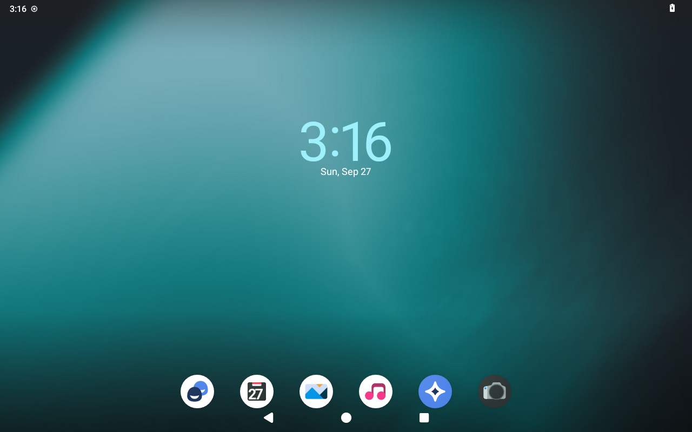

# LangeOS (LangeOS mobile)

SO móvel em Rust, leve (512 MB+) e seguro, com compatibilidade Android via container.

- Arquitetura: [`arquitetura_de_sistema_operacional_m_vel_performance_seguran_a_e_compatibilidade_android.md`](arquitetura_de_sistema_operacional_m_vel_performance_seguran_a_e_compatibilidade_android.md)
- Estratégia e status: [`docs/ESTRATEGIA.md`](docs/ESTRATEGIA.md)
- Integração futura com a distro Langeos (desktop): [`docs/INTEGRACAO-DESKTOP.md`](docs/INTEGRACAO-DESKTOP.md)

| Dir | O quê |
|---|---|
| `lange-init/` | PID 1 + supervisor de serviços (Rust) |
| `langedroid/` | Orquestrador do container Android (namespaces, freeze, reclaim) |
| `lange-compositor/` | Compositor Wayland (Smithay, composição na CPU sobre DRM) |
| `kernel/` | Kernel Linux LTS enxuto arm64 |
| `qemu/` | Boot e teste automatizado no QEMU aarch64 |

Início rápido: `kernel/build.sh && qemu/test-boot.sh`

Android (LineageOS 20) no container, desenhado pelo `lange-compositor`, no QEMU (`android/fetch.sh && GPU=virgl android/test-android.sh 600`):

## Licença

Dual: [MIT](LICENSE-MIT) ou [Apache-2.0](LICENSE-APACHE), à sua escolha. O kernel Linux baixado/compilado por `kernel/build.sh` segue GPL-2.0.
